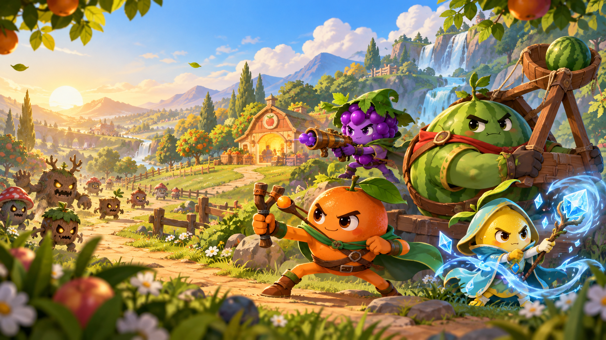

# 保卫水果 Fruit Guard

山东大学《面向对象技术》课程设计。项目使用 Java 25、JavaFX 25.0.2 和 Maven，实现一款横屏手动瞄准的水果防守游戏：玩家切换水果英雄，点击移动怪物投放水果弹药，守住终点果仓。



## 功能概览

- 8 位水果英雄、4 类怪物、8 个关卡，每关 3—8 波敌人。
- 中央手动瞄准，支持点击锁定、长按连发和拖拽蓄力弹弓。
- 金币升级、八种专属大招，以及用积分兑换的减速、炸弹和修复道具。
- 角色图鉴、关前敌情、暂停、二倍速、背景音乐和战后统计。
- 本地保存关卡解锁、最高分和星级；27 项自动化规则测试。

## 环境与运行

- JDK 25（已在 Oracle JDK 25.0.2 验证）
- Maven 3.9 或更高版本
- macOS、Windows 或 Linux 图形桌面

下载或克隆仓库后，进入包含 `pom.xml` 的项目根目录。先确认 `java -version` 和 `mvn -version` 都使用 JDK 25，再启动：

```bash
mvn javafx:run
```

首次运行需要联网，JavaFX 等依赖由 Maven 自动下载，不需要单独安装 JavaFX SDK。

macOS 也可以直接双击 `run.command`。测试和构建命令：

```bash
mvn test
mvn clean package
```

也可运行 `mvn clean verify` 完成编译、全部测试和打包。生成的 `target/fruit-guard-1.0.0.jar` 是普通模块化 JAR，未捆绑 JavaFX 和运行时；启动游戏请使用上面的 Maven 命令。

## 游戏操作

1. 在原创封面点击“开始守护”，进入关卡选择。
2. 点击关卡后先查看实际敌情、各波阵容，再选择首发水果进入战斗；战中仍可随时切换。
3. 水果从战场中下方的中央发射。默认点击怪物锁定射击，按住左键持续发射；点击空地向落点投掷。按 `M` 切换弹弓模式，从中央拖动并松手，向拉动的反方向发射，蓄力影响弹速与伤害。
4. 击杀怪物获得积分、金币和大招能量，金币用于升级当前水果武器。
5. 能量达到 100 后，点击大招按钮或按空格键释放当前水果的专属大招。
6. 击杀还增加“可用积分”，在右侧“积分道具”页签兑换寒霜、炸弹和修复；不会扣减本局总积分。
7. 胜利后按剩余生命评定一至三星，记录本关最高分和最高星级，可直接进入下一关。

快捷键：

- `1`—`8`：切换八种水果英雄
- `Space`：释放当前水果的专属大招
- `M`：切换点击瞄准 / 弹弓蓄力模式
- `Q`：寒霜风暴，120 可用积分，全场减速 4 秒
- `E`：果实炸弹，180 可用积分，在最后瞄准位置爆炸
- `R`：果仓修复，200 可用积分，恢复 2 点生命，上限 8
- `P` 或 `Esc`：暂停或继续

图鉴与玩法说明打开时会自动暂停战斗，关闭后恢复原状态；返回选关前会确认是否放弃当前战斗。

## 水果英雄

| 水果武器 | 基础伤害 | 普通攻击 | 专属大招 |
|---|---:|---|---|
| 橙光弹弓 | 34 | 精准重弹 | 日耀贯穿 |
| 葡萄连发炮 | 13 | 高频连续射击 | 万籽弹幕 |
| 西瓜重投器 | 55 | 落点范围爆炸 | 瓜星坠落 |
| 冰柠法杖 | 22 | 命中减速 | 绝对零度 |
| 草莓连锁杖 | 28 | 连锁弹跳，最多三个目标 | 莓雨连锁 |
| 菠萝穿甲枪 | 48 | 直线贯穿，最多三个目标 | 金棘破阵 |
| 蓝莓霜爆炮 | 26 | 范围伤害并减速 | 极夜霜环 |
| 蜜桃守护杖 | 46 | 高伤花瓣弹 | 桃源复苏 |

每种武器均可使用金币升至 3 级。八种大招拥有不同的目标选择、伤害范围和控制效果；蜜桃大招还可恢复两点果仓生命，上限为 8 点。所有水果从第一关即可自由选择。

上表是一级基础击打点数。武器卡会实时显示升级后的实际击打点数与冷却；弹弓模式的伤害系数为 `0.75 + 0.75 × 蓄力比例`，最高为基础的 1.5 倍。例如第一关中，二级西瓜可一击消灭疾风狐，同样一击无法消灭铁甲野猪。

## 怪物与关卡

| 怪物 | 基础血量 | 速度 | 击杀积分 | 特点 |
|---|---:|---:|---:|---|
| 果冻怪 | 85 | 58 | 25 | 普通单位 |
| 疾风狐 | 62 | 94 | 32 | 高速低血量 |
| 铁甲野猪 | 210 | 39 | 58 | 重甲高血量 |
| 贪吃王 | 780 | 30 | 180 | Boss，抵达终点扣除 3 点生命 |

| 关卡 | 波数 | 战斗特点 |
|---|---:|---|
| 青苹果原野 | 3 | 新手练习 |
| 葡萄峡谷 | 4 | 混合敌群 |
| 西瓜火山 | 5 | 重甲推进 |
| 草莓花径 | 4 | 密集短波，适合连锁 |
| 冰蓝湖畔 | 6 | 高速突袭，适合减速 |
| 菠萝古堡 | 5 | 直线重甲方阵，适合贯穿 |
| 蜜桃云境 | 7 | 持久防守，适合恢复 |
| 丰收王庭 | 8 | 混合终局挑战 |

- 八关依次解锁，已有最高分与解锁记录继续保留
- 每种怪物首次出场时会显示名称、血量、速度、奖励和特点
- 关前预览和战场悬停显示计入难度后的怪物实际属性，图鉴列出基础属性
- 结算展示击败数量、发射次数、命中率、生命和战斗用时；7—8 点生命为三星，4—6 点为二星，1—3 点为一星

## 界面与音频

- 原创横屏封面、果园战场、八位水果英雄和四类怪物美术
- 封面、选关、战斗、暂停与结算五种界面状态
- 使用 JDK MIDI 合成器播放项目内原创循环旋律，无外部音频依赖
- 总最高分、关卡最高分、最高星级和解锁进度通过 Preferences 本地保存
- 命中数字、击杀积分与金币飘字、冲击波和装填进度提供实时战斗反馈

## 课程要求与验收

要求对应关系、示例交互分析及演示步骤见 [大纲对照与验收.md](docs/大纲对照与验收.md)。当前有 27 项规则测试，其中完整八关流程测试使用内存存档，不会改变玩家进度。自动化流程测试用于验证波次、胜负、星级与解锁，不等同于人工难度评测。

## 项目结构

```text
.
├── .github/workflows/build.yml  GitHub 自动编译、测试和打包
├── src/main/java
│   ├── module-info.java        Java 模块与依赖声明
│   └── com/oodt/fruitguard
│       ├── FruitGuardApplication.java  JavaFX 启动类
│       ├── core                流程、波次、工厂、音乐与存档
│       ├── model               怪物、武器、投射物等领域对象
│       └── ui                  封面、选关、HUD 与 Canvas 渲染
├── src/main/resources          CSS、封面、战场和角色 PNG 图集
├── src/test/java               JUnit 测试与内存存档辅助类
├── docs                        设计、验收、实验报告与上传说明
├── tools                       可选的 Word 报告生成工具
├── pom.xml                     Maven 依赖与构建配置
├── run.command                 macOS 启动脚本
└── target                      本地生成的构建产物，Git 忽略
```

推荐阅读顺序：`FruitGuardApplication` → `GameView` → `GameController` → `FruitWeapon` / `Enemy` → 各个子类与 `Projectile`。

详细设计见 [设计说明](docs/设计说明.md)，实验报告见 [保卫水果实验报告.docx](docs/保卫水果实验报告.docx)。[tools/README.md](tools/README.md) 说明可选报告工具的用法，运行游戏不需要 Python。

## 存档与验证范围

存档由 JDK Preferences 写入当前用户的系统配置区域，不在仓库或 `target/` 中；清理构建产物不会清除进度。测试使用独立的内存存档。

仓库附带 GitHub Actions，在推送和 Pull Request 时分别在 Linux、Windows 的 Java 25 环境执行 `mvn clean verify`。该流程验证编译、规则测试与打包；桌面显示、鼠标交互、音乐和实际难度仍需在图形桌面中体验。

## 素材与参考

PNG 美术由 AI 图像工具为本项目生成；背景音乐由 `MusicManager` 中的音符序列通过 JDK MIDI 合成。课程示例用于分析玩法，没有复用其代码或媒体资源。生成提示词见 [新增水果美术说明](docs/新增水果美术说明.md)，示例对照及验证范围见 [大纲对照与验收](docs/大纲对照与验收.md)。

## 上传到 GitHub

首次上传步骤见 [GitHub 上传说明](docs/GitHub上传说明.md)。提交源码、资源和项目文档即可；`target/`、IDE 配置和临时文件已由 `.gitignore` 排除。
