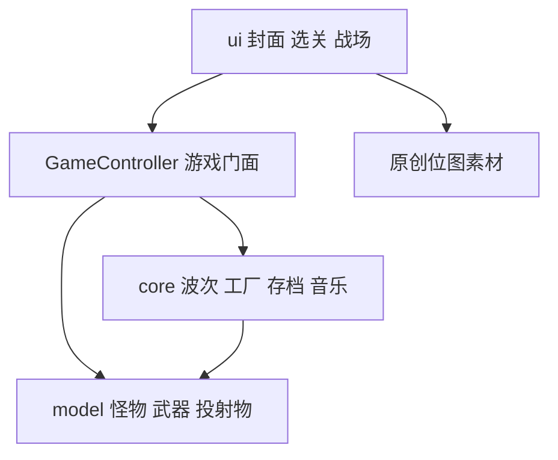
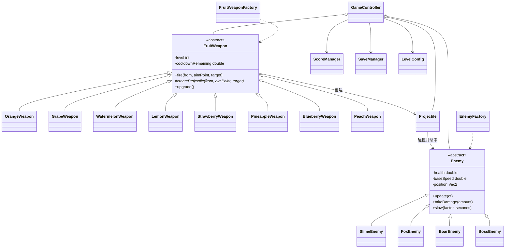
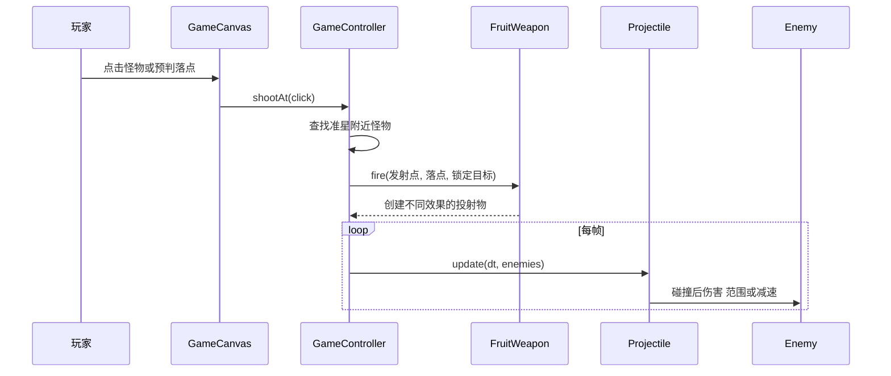

# 保卫水果面向对象设计说明

## 设计目标

游戏按照教学大纲中的“投放不同水果瞄准怪物”实现为手动瞄准玩法。界面只负责接收点击与绘制，伤害、冷却、碰撞、波次和奖励均由领域对象与控制器管理，使新增水果、怪物或关卡时不需要重写主循环。

## 分层结构

- `ui`：接收鼠标瞄准、点击发射和键盘切换，绘制原创场景与角色。
- `core`：管理关卡、波次、积分、存档、音乐和对象创建。
- `model`：保存怪物、水果武器、投射物等状态和行为。

## 核心类图

## 面向对象特性

### 抽象

`Enemy` 与 `FruitWeapon` 提取同类对象共有的数据和行为。控制器面向抽象类型更新怪物和武器，不需要判断具体子类。

### 封装

生命值、移动速度、冷却、金币和能量均为私有字段，只能通过 `takeDamage`、`fire`、`spendCoins` 等受约束方法改变。奖励通过 `claimReward` 保证只结算一次。

### 继承

四种怪物继承 `Enemy`，复用路径移动、减速和奖励逻辑；八种水果武器继承 `FruitWeapon`，复用冷却、等级和升级规则。

### 多态

`FruitWeapon.fire` 调用抽象方法 `createProjectile`。橙子、葡萄和蜜桃生成单体弹药，西瓜生成范围弹药，柠檬生成减速弹药；草莓弹药最多连锁三个目标，菠萝沿瞄准方向直线贯穿三个目标，蓝莓将范围伤害与减速组合。控制器只调用统一的 `fire` 方法。

## 关键交互

## 八种专属大招

- 橙子“日耀贯穿”：优先攻击路径进度最高的三个敌人，伤害递减。
- 葡萄“万籽弹幕”：对全场敌人造成一轮群体伤害。
- 西瓜“瓜星坠落”：以最密集的敌群为中心造成大范围高伤害。
- 柠檬“绝对零度”：全场伤害并施加长时间强减速。
- 草莓“莓雨连锁”：对前方五个目标造成递减伤害。
- 菠萝“金棘破阵”：对全场野猪和首领造成高额伤害，对其他怪物造成普通伤害。
- 蓝莓“极夜霜环”：对密集敌群造成范围伤害和强减速。
- 蜜桃“桃源复苏”：恢复两点果仓生命（上限 8 点）并对全场造成伤害。

## 中央发射与关卡配置

`GameController.LAUNCHER_POSITION` 为 `(450, 485)`，位于 900×560 战场的中下方。英雄面板、弹药起点和准星引导线均使用同一发射点；窗口缩放时按比例缩放整个战场，鼠标坐标仍使用 Canvas 本地坐标。

八关波数依次为 3、4、5、4、6、5、7、8。每关单独配置路线、敌群、生成间隔、金币和难度。选关卡片、战斗波次总数和存档解锁上限均读取关卡仓库，避免将波数或最大关卡数固定为常量。

## 双模式操作与反馈

点击模式支持单击锁定和按住左键连发。弹弓模式记录中央发射点到拖动点的向量，反向计算落点；拉距上限 105 像素，松手后按 `0.75 + 0.75 × 蓄力比例` 修正伤害，并相应修正弹速。暂停、切换模式、打开图鉴或离开战斗都会清除按住状态。

`CombatFeedback` 是不可变反馈事件。控制器比较受击前后血量、领取奖励时发布事件；Canvas 消费事件并绘制伤害、积分、金币、治疗与冲击波，领域层不依赖绘图对象。事件队列与画面特效数量均设置上限，避免持续战斗导致积累。

## 战术积分与关卡成绩

`ScoreManager` 分别管理累计总积分、可消费战术积分、升级金币和大招能量。击杀为总积分及可用积分增加相同奖励；`spendTacticalPoints` 保证兑换不透支且不降低总成绩。`SpecialAttack` 配置寒霜、炸弹、修复的名称、费用、介绍与快捷键，控制器先校验状态和目标，再扣费执行。

`BattleStatistics` 保存发射数、命中次数、击败数和战斗用时。一次范围或贯穿投射物即使命中多人，命中率也只计一次命中；大招和道具伤害不计为普通射击命中。胜利时按剩余生命授予一至三星，`SaveManager` 对每关保留最高成绩和最高星级，并兼容旧版总分及解锁键。

游戏更新将有效帧时间拆成不超过 0.05 秒的子步，最多接收 0.25 秒。二倍速传入的总时间会完整消耗。波次使用当前活动波与已完成波两个状态，防止“生成完最后一只”被错误显示为“下一波已经开始”。

测试通过 `MemoryPreferences` 注入内存存档，验证全部八关的波次、胜负和解锁不会改变玩家真实数据。

## 设计模式

- 工厂模式：`EnemyFactory` 和 `FruitWeaponFactory` 屏蔽具体子类创建。
- 门面模式：`GameController` 为界面提供瞄准、升级、大招、暂停等统一入口。
- 仓库模式：`LevelRepository` 集中保存路径与波次配置。
- 状态模式思想：`GameState` 区分菜单、运行、暂停、胜利和失败。

## 可扩展方式

- 新增怪物：增加 `EnemyKind`、`Enemy` 子类和工厂分支。
- 新增水果：增加 `FruitKind`、`FruitWeapon` 子类和专属大招分支。
- 新增关卡：在 `LevelRepository` 添加路径和波次配置。
- 更换界面：核心规则集中在控制器和模型层，Canvas 可被其他渲染方案替换。
